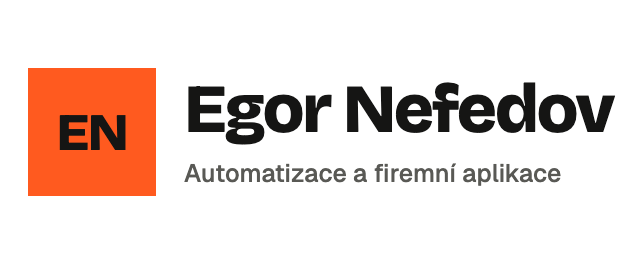

<p>
  <picture>
    <source media="(prefers-color-scheme: dark)" srcset="docs/assets/logo-dark.png">
    
  </picture>
</p>

# shoptet-admin-mcp

**Claude v administraci Shoptetu. S pojistkami.**

Neoficiální [MCP](https://modelcontextprotocol.io) server a skill pro Claude. AI asistent v nich čte a opatrně mění věci v administraci e-shopu na [Shoptetu](https://www.shoptet.cz), kterou ovládá v reálném prohlížeči přes [Playwright](https://playwright.dev). Nic se nehostuje: běží to u vás na počítači.

> **Experimentální (alfa).** Ověřeno na jednom českém shopu, na macOS. Počítejte s výpadky, když Shoptet změní administraci. Před zadáním hesla si přečtěte [Stav](#stav).
>
> Projekt nijak nesouvisí se Shoptetem, není jím schválen ani podporován. „Shoptet“ je ochranná známka svého vlastníka.

| 11 | 5 | 0 | 27 |
|:--|:--|:--|:--|
| čtecích nástrojů | zápisů s pojistkami | mazání, záměrně | offline testů |

Každé číslo výše je počet věcí, které jsou v tomto repozitáři. Nejde o měření výkonu ani o tvrzení o zákaznících.

## Proč to vzniklo

Shoptet nemá veřejné API pro velkou část toho, co obsluha dělá v administraci: kupóny, přesměrování, bannery, HTML kódy, ceníky. Automatizuji administrace e-shopů pro české firmy a pořád mě stejné pasti stály hodiny: firewall, který zablokuje celou IP, tabulky vykreslované po dávkách, formuláře, které potichu zahodí napsaný text. Tohle repo jsou ty zkušenosti, přepsané od nuly do malého nástroje s pojistkami uvnitř, a k tomu poznámky ve tvaru, který umí použít Claude.

## Co umí

**Čtení, vždy zapnuto:** informace o shopu, produkty, detail produktu, ceník (varianty, ceny, sklad), kupóny a jejich šablony, přesměrování URL, bannery, HTML kódy, objednávky bez osobních údajů.

**Zápis, ve výchozím stavu vypnutý:** založit kupon, přidat přesměrování, změnit cenu nebo sklad jedné varianty, nahradit HTML kód, nahradit banner.

Zápis není nikdy jednorázový:

```
návrh  →  přečtete shrnutí a řeknete ano  →  provedení  →  ověření  →  vrácení, když je třeba
(nic se nemění)                              (kontrola, zápis, přečtení zpět)
```

Nic se nemaže. Vrácení kuponu ukončí jeho platnost. Vrácení přesměrování smaže jen pravidlo, které nástroj sám přidal.

## Stav

- Ověřeno na **macOS**, na **české** administraci, na testovacím klonu shopu, říjen 2026: všechny čtecí nástroje a každý druh zápisu přes návrh, provedení, nezávislé přečtení a vrácení.
- **Neověřeno:** Windows, Linux, slovenská nebo anglická administrace, účty s dvoufázovým přihlášením, jiné tarify.
- Automatizace administrace nemusí být povolena u každého tarifu. **Kontrola podmínek Shoptetu pro váš tarif je na vás.**
- Shoptet administraci mění bez ohlášení. Zápisy výsledek ověřují a raději hlasitě selžou, než aby hádaly, ale selektory bude časem nutné aktualizovat.
- Offline testy pokrývají konfiguraci, validaci vstupů, životní cyklus návrhů a ukládání. Část s prohlížečem jsem ověřoval ručně proti živé administraci, ne v CI.

## Instalace

Node.js 20.6 nebo novější.

```bash
git clone https://github.com/egornefedovcz/shoptet-admin-mcp.git
cd shoptet-admin-mcp
git checkout <tag-vydani>   # používejte označené vydání, ne main, a kód si předem přečtěte (je malý)
npm install
npx playwright install chromium
cp .env.example .env        # doplňte SHOPTET_URL, SHOPTET_EMAIL, SHOPTET_PASSWORD
chmod 600 .env
```

Použijte **samostatného admin uživatele** jen s potřebnými právy a nejdřív vše vyzkoušejte na **testovacím nebo klonovaném shopu**.

Claude Code:

```bash
claude mcp add shoptet -- node --env-file=/absolutni/cesta/shoptet-admin-mcp/.env /absolutni/cesta/shoptet-admin-mcp/src/server.js
```

`--env-file` drží heslo mimo historii shellu i mimo konfiguraci Clauda. Zápisy zapnete přidáním `SHOPTET_ALLOW_WRITE=1` do `.env`. Bez toho se zápisové nástroje vůbec nezaregistrují. Když je zapnete, **nepovolujte automaticky** `shoptet_apply_change` a `shoptet_revert_change`: vaše potvrzení těchto dvou volání je skutečná pojistka ([proč](docs/safety.md)).

Skill: `cp -r skills/shoptet-admin ~/.claude/skills/`

## Kam míří vaše data

Nic neprovozuje autor. Server i prohlížeč běží u vás na počítači a mluví jen s vaším shopem. Žádná telemetrie ani účet. Co ale nástroje vrátí (texty produktů, bannery, kupóny, objednávky bez osobních údajů), jde **AI modelu, který používáte**, například Claude. Berte to jako vložení těch dat do chatu.

## Jak se chová, aby nenadělal škodu

- **Pomalu a po jednom.** Jeden prohlížeč, jeden požadavek, odstup alespoň 2,5 s. Firewall Shoptetu blokuje celou IP, e-shop i administraci, při návalu požadavků. Odpověď 403 nebo 429 spustí 30minutovou pojistku.
- **Vše ověřuje.** Zápis odmítne pokračovat, pokud se hodnota od návrhu změnila, a po zápisu znovu čte cíl i sousední pole.
- **Prohlížeč chodí jen tam, kam ho pošle server.** Otevírá stránky administrace sestavené z id, kódů a cest. Žádný nástroj nenavigue na URL od modelu. Adresa shopu je pevně daná v `SHOPTET_URL`.
- **Tajemství jen v prostředí.** Heslo se nikdy nelogguje ani nevrací a z chybových hlášek se maže.
- **Obsah shopu je označen jako nedůvěryhodný** v každém výsledku čtení.

Podrobnosti anglicky: [jak to funguje](docs/how-it-works.md), [bezpečnostní model](docs/safety.md), [reference skillu](skills/shoptet-admin/references/).

## O autorovi

Jsem Egor Nefedov, Praha. Stavím automatizace a interní aplikace, které českým firmám berou z rukou přepisování, tabulky a opakované dotazy. Víc na [nefedov.cz](https://nefedov.cz).

Licence MIT, viz [LICENSE](LICENSE). Anglická verze s úplným popisem nástrojů: [README.md](README.md).
